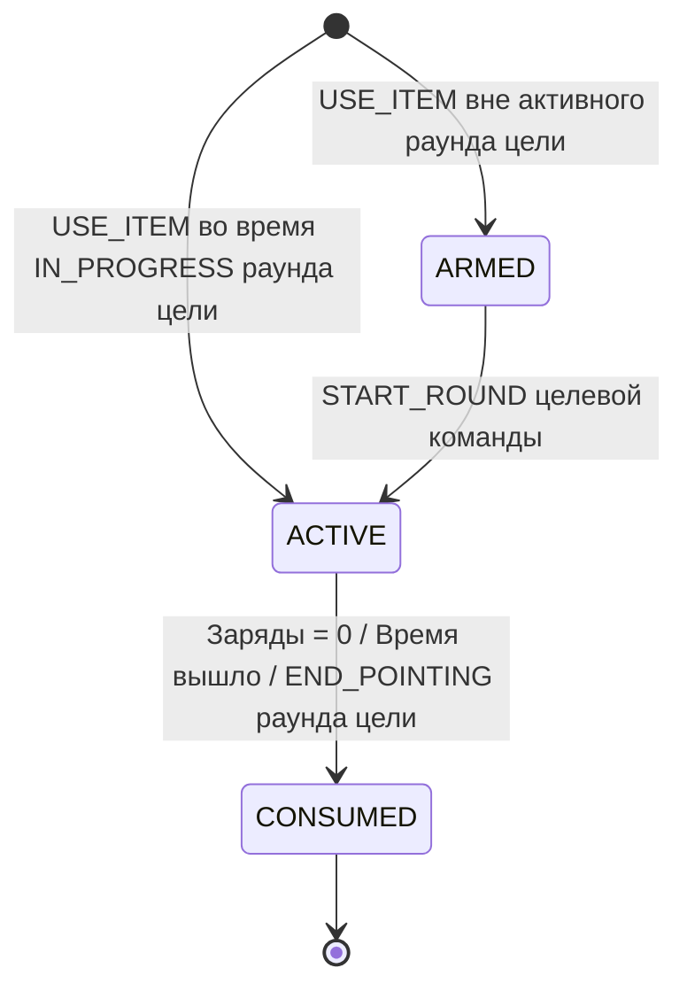
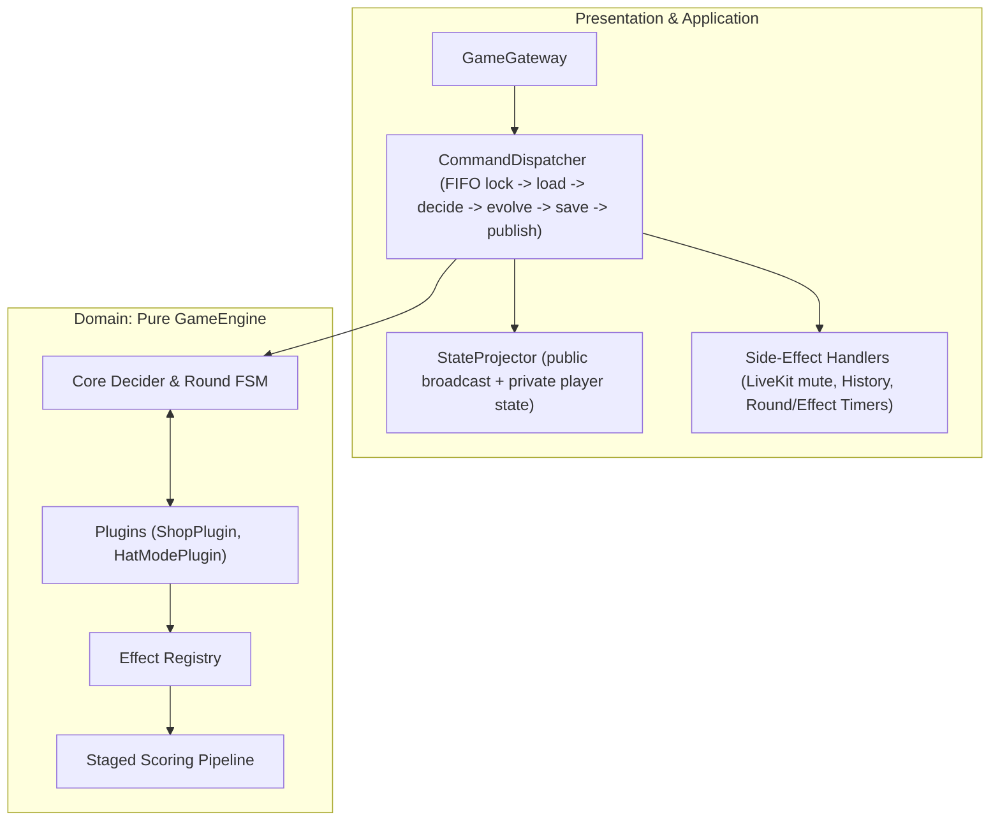

# Спецификация механики магазина и целевой архитектуры игрового движка

Документ фиксирует продуктовые и архитектурные решения по системе внутриигрового магазина, предметов/эффектов и рефакторингу игрового движка Alias.

---

## 1. Продуктовые решения по механике магазина

### 1.1. Включение и конфигурация магазина
- **Настройка комнаты:** Владелец комнаты в лобби управляет только одним переключателем — `isShopEnabled: boolean` (включён или выключен магазин).
- **Серверный каталог:** Набор предметов, их стоимость, длительность, лимит инвентаря, стартовый баланс и формула дохода задаются фиксированным декларативным конфигом на сервере (без необходимости менять код ядра при балансировке цифр).
- **Условная доступность предметов:** Предмет в каталоге может требовать включённой настройки комнаты (`requiresSetting`). Если условие не выполнено, предмет не отображается в магазине и не может быть куплен.

### 1.2. Кошелёк, валюта и инвентарь
- **Отдельная валюта (`coins`):** Покупки совершаются за специальную внутриигровую валюту поинтов, которая не влияет на победный счёт команды (`team.score`).
- **Персональное владение:** У каждого игрока (`PlayerState`) свой **личный кошелёк (`wallet`)** и **личный инвентарь (`inventory`)**.
- **Лимит инвентаря:** У игрока есть ограничение на количество одновременно хранимых предметов в инвентаре (например, `MAX_INVENTORY_SIZE = 3`), чтобы исключить накопление десятка предметов к концу матча.

### 1.3. Заработок валюты
- **Момент начисления:** Валюта начисляется **только при завершении фазы ревью раунда (`END_POINTING`)**, когда список угаданных и пропущенных слов окончательно подтверждён.
  - *Почему так:* Исключает абуз быстрыми кликами «угадано» во время раунда с немедленной тратой валюты до того, как слова отменят на ревью, и избавляет от отрицательного баланса или отката покупок.
- **Формула дохода за раунд:**
  - Объясняющий игрок (`explainer`) получает **`X` поинтов** за каждое засчитанное (`guessed`) слово в раунде.
  - Остальные игроки активной команды — отгадывающие (`guessers`) — получают **`Y` поинтов** (`Y < X`) за каждое засчитанное слово в раунде.
  - В начале игры при `START_GAME` каждому игроку в командах может выдаваться стартовый баланс `INITIAL_COINS` (задаётся в конфиге экономики).

### 1.4. Покупка и использование предметов
- **Разделение действий:**
  1. `BUY_ITEM` — списывает стоимость из личного кошелька игрока и кладёт экземпляр предмета в его личный инвентарь.
  2. `USE_ITEM` — забирает предмет из личного инвентаря игрока и создаёт эффект на выбранную цель (`self_team`, `enemy_team`, `enemy_player`).
- **Доступность во времени:** Покупать и использовать предметы может **любой игрок команды персонально в любой момент активной игры (`GameStatus.IN_PROGRESS`)** в любой фазе раунда (`PENDING`, `IN_PROGRESS`, `POINTING`, `FINISHED`).
- **Идемпотентность:** Команды покупки и применения принимают `clientRequestId`, чтобы при повторной отправке сокет-сообщения предмет не купился и не списался дважды.

---

## 2. Жизненный цикл и правила работы эффектов

### 2.1. Типы длительности (`durationType`)
У каждого предмета в каталоге задаётся свой тип времени жизни:
1. **`instant`** — срабатывает мгновенно в момент применения и сразу завершается (например, `+15 секунд к таймеру раунда`).
2. **`seconds`** — действует ровно `N` секунд реального времени с момента применения (`expiresAt = now + durationMs`), например мут на 5 секунд или заморозка кнопки следующего слова на 5 секунд.
3. **`charges`** — действует до исчерпания `N` зарядов (например, `бесплатный пропуск слова` на 1 пропуск). Висит на цели до тех пор, пока не сработает нужное число раз.
4. **`round`** — действует в рамках одного раунда целевой команды (например, `×2 очка своей команде`, `−2 за пропуск вражеской команде`).

### 2.2. Правило «только на будущее» (взведение и отсутствие ретроактивности)
Поскольку применять предметы можно в любой момент игры, действует единое правило: **эффекты никогда не меняют прошлое задним числом**.



- **Если эффект типа `seconds` применён сейчас** (например, мут или блокировка кнопки на 5 сек) — он переходит в `ACTIVE` немедленно и действует следующие 5 секунд.
- **Если эффект типа `round` применён во время идущего раунда (`IN_PROGRESS`) целевой команды** — он сразу становится `ACTIVE`, но влияет **только на те слова, которые будут разыграны после момента применения**. Слова, уже сыгранные в этом раунде до нажатия кнопки, сохраняют свои прежние правила подсчёта.
- **Если эффект типа `round` применён, когда целевая команда не объясняет слова** (идёт раунд другой команды, либо текущая фаза — `PENDING`, `POINTING` или `FINISHED`) — эффект переходит в статус **`ARMED` (взведён)**. Как только у целевой команды начинается следующий раунд (`START_ROUND`), эффект автоматически переходит в `ACTIVE` и действует весь этот раунд до `END_POINTING`.

### 2.3. Сложение эффектов (Stacking)
- **Одинаковые эффекты на одну цель НЕ складываются (`unique`):** Пока на цели (команде или игроке) уже висит эффект конкретного типа в статусе `ARMED` или `ACTIVE`, применить второй такой же эффект на эту же цель нельзя.
  - Доменный guard отклоняет команду `USE_ITEM`, предмет остаётся в инвентаре игрока, ничего не сгорает.
- **Разные эффекты складываются по стадиям:** На одной цели одновременно могут действовать разные по типу эффекты (например, `×2 очка` и `бесплатный пропуск`). Они применяются в фиксированном порядке стадий пайплайна подсчёта очков.
- В схеме каталога закладывается поле `stacking: 'unique' | 'stack' | 'queue'`, где по умолчанию используется `'unique'`.

### 2.4. Видимость информации (Public vs Private)
| Данные | Кто видит | Причина |
|---|---|---|
| **Активные и взведённые эффекты (`ARMED` / `ACTIVE`)** | **Все игроки в комнате**, включая имя автора и цель | Даёт социальный фидбек («Вася повесил −2 за пропуск на Синих») и возможность контригры (стараться не пропускать слова) |
| **Баланс поинтов (`wallet`)** | **Все игроки в комнате** | Прозрачная экономика матча |
| **Инвентарь (`inventory`)** | **Только владелец инвентаря** | Сохраняет интригу, какие предметы куплены и припасены у соперников |

---

## 3. Стартовый каталог предметов

| ID предмета | Название и суть | Условие доступности | Цель (`target`) | Длительность | Как работает в движке |
|---|---|---|---|---|---|
| `DOUBLE_POINTS` | **×2 поинты своей команде** за угаданные слова | Всегда (при `isShopEnabled`) | `self_team` | `round` | Стадия `multiplicative`: для слов со статусом `guessed`, сыгранных при активном эффекте, умножает положительные очки на `2` |
| `ENEMY_SKIP_PENALTY` | **−2 за пропуск слова** вражеской команде | Всегда | `enemy_team` | `round` | Стадия `additive`: для слов со статусом `skipped`, сыгранных при активном эффекте, добавляет `−1` к базовому штрафу `−1` (итого `−2`) |
| `FREE_SKIP_SHIELD` | **Бесплатный пропуск слова** | Всегда | `self_team` | `charges: 1` | Стадия `override`: при пропуске слова (`skipped`) выставляет очки за слово в `0` вместо штрафа и списывает 1 заряд |
| `FREEZE_NEXT_WORD` | **Блок кнопки следующего слова** на 5 секунд | Всегда | `enemy_player` (или текущий `explainer`) | `seconds: 5` | Доменный `CommandGuard` блокирует команду `RESOLVE_WORD` (угадано/пропуск) от целевого игрока, пока `now < expiresAt` |
| `VOICE_MUTE` | **Голосовой мут игрока** на 5 секунд | **Только если `isVoiceChatEnabled === true`** | `enemy_player` | `seconds: 5` | При `EffectApplied` адаптер `VoiceService` серверно отключает микрофон участника в LiveKit; по истечении 5 сек (`EffectExpired`) включает обратно |

> [!IMPORTANT]
> **Разделение голосового мута и заморозки кнопки:**
> Если в настройках комнаты голосовой чат выключен (`isVoiceChatEnabled: false`), предмет `VOICE_MUTE` автоматически убирается из магазина. Предмет `FREEZE_NEXT_WORD` (блокировка кнопки следующего слова на N секунд) доступен в магазине всегда.

---

## 4. Архитектура игрового движка

### 4.1. Почему уходим от текущего `GameEntity` и мутирующего списка аддонов
1. **Единый агрегат комнаты сохраняется:** Комната остаётся одной границей консистентности (один ключ в Redis, одна FIFO-очередь команд). Дробить комнату на отдельные репозитории нельзя.
2. **Убираем God Object (`GameEntity`):** Вместо 45 методов в одном классе логика делится на ядро (переходы фаз и базовые правила) и изолированные плагины.
3. **Убираем хрупкость текущего `GameEngine`:**
   - Вместо нетипизированных `scoreDelta / multiplier / isCancelled` — стадийный пайплайн расчёта очков.
   - Вместо мгновенного изменения счёта команды на каждом слове с последующим `clamp(-1, 1)` на ревью — хранение **исхода слова + снимка активных эффектов**, и чистый пересчёт очков на `END_POINTING`.
4. **Единая терминология ролей в раунде:**
   - **`explainer` (`explainerId`)** — ведущий раунда, который **объясняет** слова (ранее ошибочно назывался `guesserId`).
   - **`guessers`** — остальные игроки активной команды, которые **отгадывают** слова.

### 4.2. Ядро: Decider + FSM фаз + Реестр плагинов и эффектов



#### 1. Чистый цикл обработки команд (Decider pattern)
Движок не зависит от `Date.now()`, `Math.random()` или внешних сервисов — время и случайность передаются через `EngineContext`:
```ts
interface EngineContext {
  now: number;
  idGenerator: () => string;
  random: () => number;
}

// 1. Проверка guard'ов и бизнес-правил -> возвращает список событий (без мутации state)
decide(command: GameCommand, state: GameState, ctx: EngineContext): GameDomainEvent[];

// 2. Единственное место изменения state — чистая функция evolve
evolve(state: GameState, event: GameDomainEvent): GameState;
```

#### 2. Запись слова со снимком эффектов (решение проблемы ревью + «только на будущее»)
Когда объясняющий нажимает «Угадано» или «Пропуск» (`RESOLVE_WORD`), слово сохраняется в историю раунда в таком виде:
```ts
interface PlayedWordRecord {
  id: string;
  text: string;
  outcome: 'guessed' | 'skipped' | 'neutral';
  /** ID эффектов, которые были ACTIVE на команду в момент разыгрывания этого слова */
  appliedEffectIds: string[];
  /** Итоговые очки за слово (пересчитываются функцией scoreWord при разыгрывании и при ревью) */
  score: number;
  /** Расшифровка для UI: почему слово стоит именно столько (например, База +1, x2 = +2) */
  breakdown: Array<{ label: string; deltaOrMult: string }>;
}
```
Почему это важно:
- Если эффект `DOUBLE_POINTS` или `ENEMY_SKIP_PENALTY` применили в середине раунда, у предыдущих слов `appliedEffectIds` пустой, а у новых — содержит ID эффекта.
- На фазе ревью (`POINTING`) игроки меняют **только `outcome`** слова (`guessed` ↔ `skipped` ↔ `neutral`), после чего `scoreWord(word, roundEffects)` заново вычисляет `word.score` по стадиям:
  1. `base`: `guessed -> +1`, `skipped -> -1`, `neutral -> 0`
  2. `additive`: например `ENEMY_SKIP_PENALTY` превращает `-1` в `-2`
  3. `multiplicative`: например `DOUBLE_POINTS` превращает `+1` в `+2`
  4. `override`: например `FREE_SKIP_SHIELD` превращает штраф за пропуск в `0`
- При `END_POINTING` сумма `word.score` всех слов раунда прибавляется к `team.score` и `explainer.score`, а за все слова с `outcome === 'guessed'` начисляется валюта `coins` (`X` объясняющему `explainer`, `Y` отгадывающим сокомандникам `guessers`).

#### 3. Работа с таймерами (Mute / Freeze на 5 секунд)
- **Источник истины — `expiresAt` в состоянии эффекта:** Доменный guard проверяет `effect.status === 'ACTIVE' && ctx.now < effect.expiresAt`. Даже если сервер перезапустится, блокировка кнопки перестанет действовать ровно через 5 секунд без участия таймера.
- **Таймер в `RoundScheduler` нужен для UX и внешних систем:** При появлении события `EffectApplied` с `expiresAt` планировщик ставит таймер на `durationMs`, который диспатчит системную команду `EXPIRE_EFFECT { effectId }`. Это снимает мут в LiveKit и отправляет клиентам обновлённый список эффектов.

#### 4. Публичная и приватная проекции
- В публичный `GameResponseDetailsDto` / `PlayerResponseDto` добавляются:
  - `players[].wallet: number` (публичный баланс);
  - `activeEffects: PublicEffectDto[]` (список всех `ARMED` и `ACTIVE` эффектов с `id`, `itemId`, `sourcePlayerId`, `targetTeamId`/`targetPlayerId`, `status`, `expiresAt`, `remainingCharges`);
  - `shopCatalog: ShopItemDto[]` (отфильтрованный по настройкам комнаты каталог, без `VOICE_MUTE`, если голосовой чат выключен).
- В приватное состояние игрока (`getPrivatePlayerState` + сокет-событие `privateInventoryUpdated` только на сокет владельца) добавляется:
  - `inventory: InventoryItemDto[]`.

---

## 5. Пошаговый план реализации

1. **Шаг 0 — Выравнивание текущей ветки и терминологии:**
   - Перевести терминологию ведущего раунда в `GameEngine` на `explainer` (`explainerId`), сохранив обратную совместимость в сериализации.
   - Привести состояние игры в Redis к единой схеме, устранить рассинхрон между `GameEntity` и `GameEngine` и коллизию имён событий (`GameStartedEvent` / `RoundFinishedEvent` / `GameFinishedEvent`) с модулями `history` и `user`.
2. **Шаг 1 — Ядро движка и стадийный подсчёт очков:**
   - Описать единый `GameState`, команды, события, FSM фаз раунда и чистый стадийный расчёт `scoreWord` с `appliedEffectIds` на каждом слове.
3. **Шаг 2 — Плагин магазина (`ShopPlugin`) и реестр эффектов:**
   - Реализовать серверный каталог предметов, кошельки (`wallet`), приватные инвентари (`inventory`), начисление `X / Y` поинтов на `END_POINTING`, команды `BUY_ITEM`, `USE_ITEM`, `EXPIRE_EFFECT`.
   - Реализовать 5 стартовых предметов: `DOUBLE_POINTS`, `ENEMY_SKIP_PENALTY`, `FREE_SKIP_SHIELD`, `FREEZE_NEXT_WORD`, `VOICE_MUTE` (с фильтрацией по `isVoiceChatEnabled`).
4. **Шаг 3 — Интеграция в Application / Presentation (Backend):**
   - Подключить `VoiceService` к событиям `VOICE_MUTE` (mute/unmute участника в LiveKit).
   - Подключить `RoundScheduler` для `EXPIRE_EFFECT`.
   - Вывести публичные (`wallet`, `activeEffects`, `shopCatalog`) и приватные (`inventory`) поля в DTO и `GameGateway`.
5. **Шаг 4 — Frontend (FSD):**
   - Переключатель `isShopEnabled` в настройках лобби.
   - Виджет магазина и личного инвентаря в активной игре, отображение баланса, активных/взведённых эффектов на командах и игроках, таймера блокировки кнопки следующего слова и разбивки очков на экране ревью.
