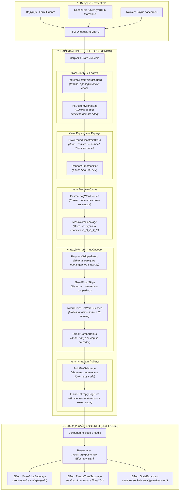

# Alias Game - Architecture & Features Documentation

## Project Overview
Alias Game is a real-time multiplayer word-guessing game built with modern web technologies. Players form teams and try to guess words based on their teammates' descriptions within a time limit.

---

## Backend Architecture

### Technology Stack
- **Framework**: NestJS (TypeScript)
- **Real-time Communication**: Socket.IO
- **Data Store**: Redis
- **Authentication**: JWT (JSON Web Tokens)
- **API Documentation**: Swagger/OpenAPI

### Architectural Layers

#### 1. **Controller Layer** (`application/`)
- `GameController` - REST API endpoints for game management
- `UserController` - Authentication endpoints
- Handles HTTP requests and response formatting

#### 2. **Gateway Layer** (`application/`)
- `GameGateway` - WebSocket event handlers for real-time game events
- `AuthGateway` - WebSocket authentication and connection management
- Manages socket connections and real-time event broadcasting

#### 3. **Service Layer** (`application/`)
- `GameService` - Core business logic for game operations
- `AuthService` - User authentication and token generation
- `DictionaryService` - Word management for different difficulty levels
- `TokenService` - JWT token handling

#### 4. **Domain Layer** (`domain/entities/`)
- `GameEntity` - Game state and logic
- `TeamEntity` - Team management
- `RoundEntity` - Round state and word management
- `PlayerEntity` - Player state and scoring
- Pure business logic with no external dependencies

#### 5. **Repository Layer** (`repository/`)
- `IGameRepository` - Repository pattern interface
- `RedisGameRepository` - Redis-based persistence
- Abstracts data access logic

#### 6. **Infrastructure Layer** (`common/infrastructure/`)
- `RedisService` - Redis connection and lifecycle management
- Connection pooling and error handling

#### 7. **Security Layer** (`common/`)
- `JwtStrategy` - Passport JWT strategy
- `JwtAuthGuard` - Route protection
- `GetAuthenticatedUser` - User extraction from JWT

### Data Flow

```
HTTP Request/WebSocket Event
    ↓
Controller/Gateway
    ↓
Service (Business Logic)
    ↓
Domain Entity (Validation & Rules)
    ↓
Repository (Data Access)
    ↓
Redis (Persistence)
```

## Frontend Architecture

### Technology Stack
- **Architecture**: FSD v2.1 (Pages First)
- **Framework**: React 19 + TypeScript
- **Build Tool**: Vite
- **State Management**: Zustand
- **API Client**: Openapi-fetch + openapi-react-query
- **Real-time Communication**: Socket.IO
- **Styling**: CSS Modules
- **Routing**: React Router v6

### Architectural Patterns

#### 1. **Feature-Based Structure**
```
src/
├── app/              # App configuration & routing
├── entities/         # Business logic & state (domain models)
├── pages/           # Page components
├── shared/          # Shared utilities & components
└── widgets/         # Reusable complex components
```

#### 2. **State Management Layers**

**Entity State Slices** (`entities/`)
- `useAuth` - Authentication state (Zustand + persist)
- `useGameSlice` - Game state management
- Centralized, persistent state

**Sync Hooks** (`pages/game/model/`)
- `useGameSync` - Synchronizes game state with real-time updates from server

#### 3. **Custom Hooks Pattern**

**API Hooks** (`pages/game/model/`)
- `useGameSession` - Fetch game data on load
- `useLobbyActions` - Emit lobby events (create team, start game)
- `useActiveGameActions` - Handle active game events (start round, next word)
- `useActiveGameSync` - Listen for real-time game updates
- `useKickHandler` - Handle player kick events

**Direct API Calls** (`pages/game/api/`)
- Async functions for API operations (next-word, start-round, etc.)
- Called within hooks or effects

#### 4. **Component Hierarchy**

```
App
└── BaseLayout (Auth check, user sync)
    └── Routes
        ├── LoginPage
        └── PrivateLayout (Protected)
            ├── GamesPage (List & create games)
            └── GamePage (Main game)
                ├── LobbyView (Team setup)
                │   ├── SettingsPanel
                │   ├── TeamCard*
                │   └── UnassignedPlayersList
                ├── ActiveGameView (Gameplay)
                │   ├── TeamView*
                │   ├── RoundInProgressBlock
                │   └── RoundFinishedResults
                └── GameFinished
```

#### 5. **Data Flow**

```
User Action (UI)
    ↓
Hook (useActiveGameActions, useLobbyActions)
    ↓
socketClient.emit() / API call
    ↓
Backend processes
    ↓
Socket broadcast / HTTP response
    ↓
Hook listener / useQuery callback
    ↓
State Update (Zustand)
    ↓
Component Re-render
```

### API Integration

- **Query Library**: `openapi-react-query` for typed REST endpoints
- **Socket.IO Client**: Real-time event communication
- **Type Safety**: Auto-generated types from OpenAPI spec (v1.d.ts)

---

## Implemented Features

### Authentication
- ✅ User login with name-based identification
- ✅ JWT token generation and validation
- ✅ Token persistence (localStorage via Zustand)
- ✅ WebSocket authentication on connect
- ✅ Protected routes with PrivateLayout

### Game Management
- ✅ Create game rooms with custom settings
- ✅ Join public games or private games with code
- ✅ Game code validation for private rooms
- ✅ Delete games (owner only)
- ✅ List all available games with sorting (newest first)
- ✅ Refresh game list

### Game Settings
- ✅ Game name configuration
- ✅ Public/Private toggle
- ✅ Time limit per turn (60 seconds configurable)
- ✅ Points to win (30 points default)
- ✅ Word difficulty selection (easy/medium/hard)
- ✅ Auto-generated room code for private games

### Lobby Management
- ✅ Team creation with custom names
- ✅ Team deletion
- ✅ Player assignment to teams
- ✅ Player movement between teams
- ✅ Unassigned players list
- ✅ Ready status toggle per player
- ✅ Game start when all players ready (owner only)
- ✅ Room code display and copy functionality

### Active Gameplay
- ✅ Round progression (PENDING → IN_PROGRESS → FINISHED)
- ✅ Word display with timer countdown
- ✅ Skip word functionality
- ✅ Word scoring (points adjustment with +/- buttons)
- ✅ Round results display
- ✅ Team score tracking
- ✅ Next round button (owner only)
- ✅ Real-time turn indicator

### Player Management
- ✅ Player kick from game (owner only)
- ✅ Automatic cleanup on disconnect
- ✅ Player state persistence
- ✅ Player readiness tracking

### Game Finish
- ✅ Game completion detection
- ✅ Winner determination
- ✅ Game deletion after finish (owner only)
- ✅ Return to games list

### Real-time Features
- ✅ WebSocket-based event broadcasting
- ✅ Live team updates
- ✅ Live player state sync
- ✅ Live score updates
- ✅ Live round state changes
- ✅ Simultaneous multi-player updates

### UI/UX
- ✅ Responsive design with CSS Modules
- ✅ Loading states and spinners
- ✅ Toast-like notifications via console
- ✅ Disabled state management for buttons
- ✅ Timer component with countdown display
- ✅ Icon library (lucide-react)
- ✅ Game list sorting and filtering

### Data Persistence
- ✅ Redis-based game state persistence
- ✅ User session tracking
- ✅ Game history retention
- ✅ User-room mapping for quick lookup

---

## Key Design Decisions

### Backend
- **Redis for State**: Fast, in-memory storage perfect for real-time games
- **Entity-Service-Repository**: Clean separation of concerns
- **WebSocket Events**: Real-time updates without polling
- **JWT Authentication**: Stateless, scalable auth mechanism

### Frontend
- **Zustand State**: Simple, lightweight state management without boilerplate
- **Custom Hooks**: Encapsulate complex logic and side effects
- **OpenAPI Types**: Eliminate manual type definitions for API
- **Socket.IO Client**: Proven library for real-time communication
- **CSS Modules**: Scoped styling, avoid naming conflicts

---

## Getting Started
Setup .env

### Backend
```bash
cd backend
npm install
npm run start:dev
```

### Frontend
```bash
cd frontend
npm install
npm run dev
```

See individual backend README and frontend README for detailed setup instructions.

---

## Game Addons & Interceptors Architecture (Event Pipeline)

Архитектура игровых модификаторов и дополнений построена на базе **пайплайна луковицы (Onion Interceptor Pipeline)** и **FIFO-очереди событий на уровне комнаты**, с выполнением сайд-эффектов через **паттерн Command (исполняемые функции без if/else)**.

### Архитектурная диаграмма



### Декомпозиция аддонов по функциям-интерсепторам

#### 1. Шляпа (Hat Mode Preset)
- **`RequireCustomWordsGuard`**: Блокирует старт игры в лобби, пока каждый игрок команды не сдал нужное количество слов.
- **`InitCustomWordsBag`**: При старте собирает все введенные слова в общий массив `state.bagWords` и перемешивает их.
- **`CustomBagWordSource`**: Перехватывает запрос слова и выдает его из шляпы вместо стандартных паков.
- **`RequeueSkippedWord`**: При пропуске возвращает слово обратно в мешок (в конец очереди).
- **`FinishOnEmptyBagRule`**: Завершает игру, когда мешок со словами полностью опустел.

#### 2. Хаос (Chaos Mode Preset)
- **`DrawRoundConstraintCard`**: Перед началом каждого раунда выбирает ограничение («Без глаголов», «Шепотом», «С акцентом»).
- **`RandomTimeModifier`**: Динамически регулирует время раунда (например, «Блиц 30 секунд»).
- **`StreakComboBonus`**: Начисляет бонусные баллы за серию из 4+ правильных отгадок без пропусков.

#### 3. Магазин (Shop / Sabotage Preset)
- **`AwardCoinsOnWordGuessed`**: Начисляет внутриигровые монеты отгадчику и ведущему.
- **`ShieldFromSkips`**: Отменяет штраф `-1` за пропуск слова на текущий раунд.
- **`PointTaxSabotage`**: Переводит 30% очков соперника на баланс команды покупателя.
- **`MaskWordSabotage`**: Подменяет буквы слова на маску `_` перед отправкой клиенту ведущего.
- **`FreezeTimeSabotage` (Effect)**: Вызывает серверную функцию сокращения таймера у активной команды на 15 секунд.
- **`MuteVoiceSabotage` (Effect)**: Вызывает функцию LiveKit SDK для временного заглушения микрофона игрока на 15 секунд.

### Концепция Callable Effects (Паттерн Command)
Вместо хранения строк `{ type: 'MUTE_VOICE' }` и огромных блоков `switch/case`, эффекты представляют собой исполняемые функции:
```typescript
type GameEffect = (services: GameServices) => Promise<void>;
```
Интерсептор регистрирует эффект:
```typescript
ctx.addEffect(async (services) => {
  await services.voice.mute(roomId, targetPlayerId, 15_000);
  services.sockets.to(roomId).emit('playerMuted', { targetPlayerId, duration: 15 });
});
```
Движок последовательно вызывает `await effect(this.services)`, обеспечивая полную изоляцию и чистоту кода ядра.